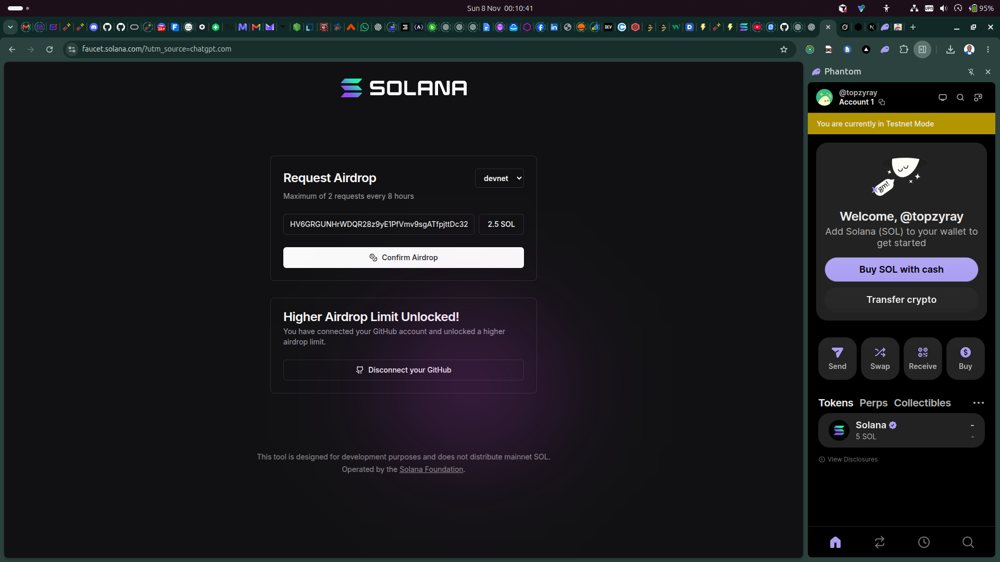
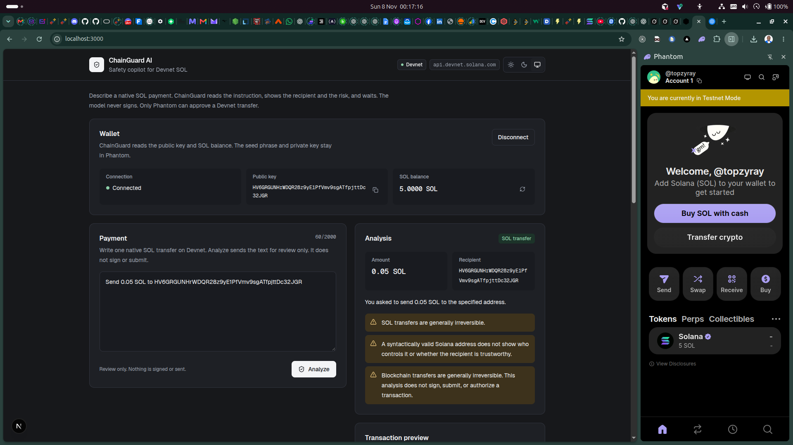
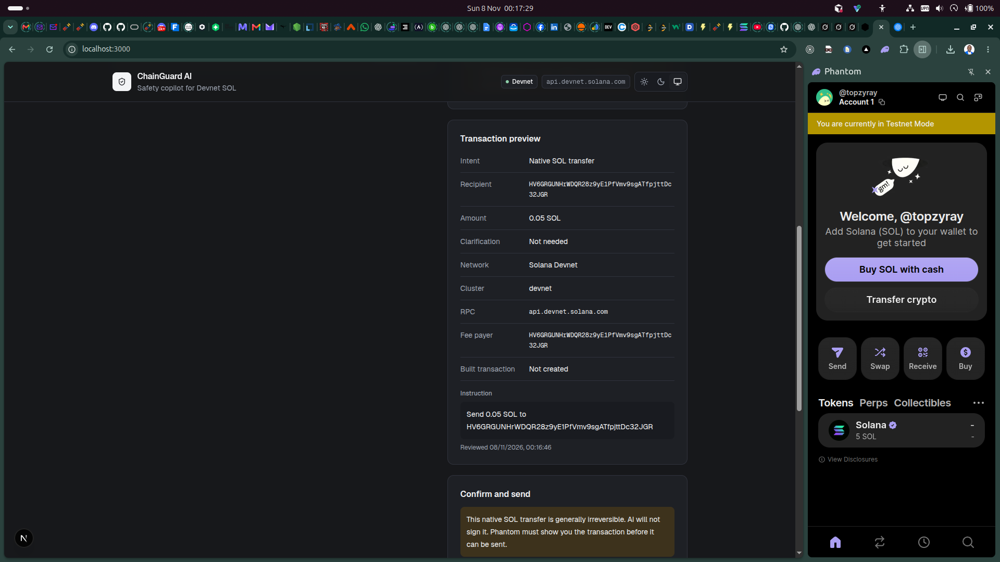
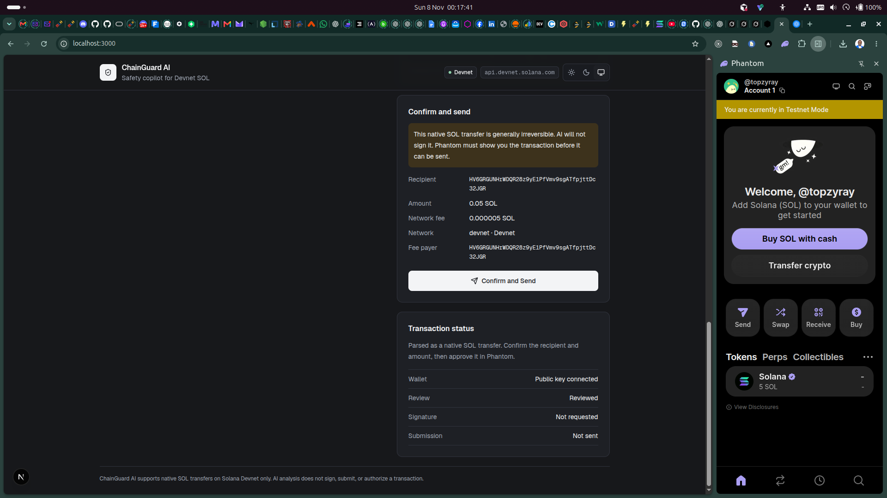
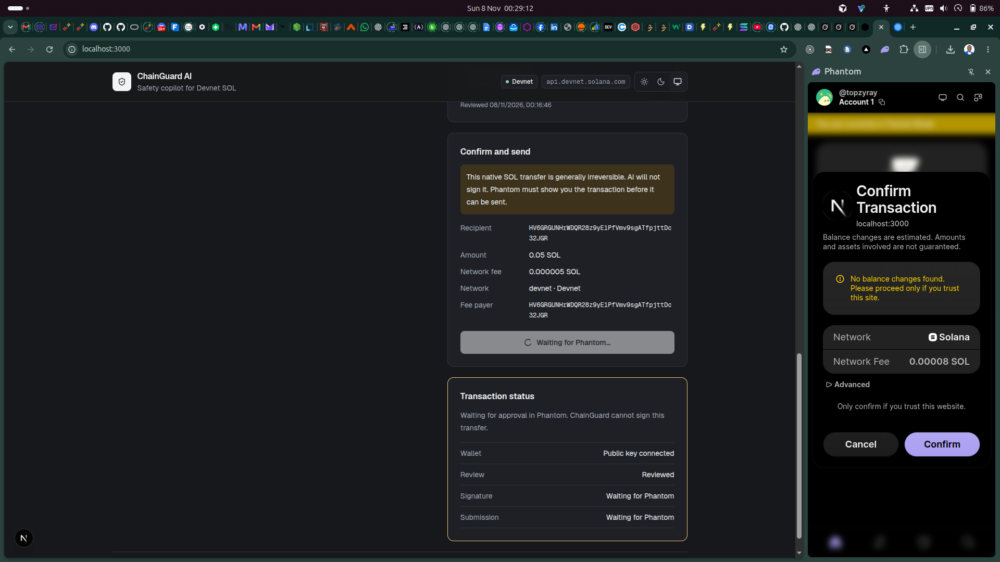
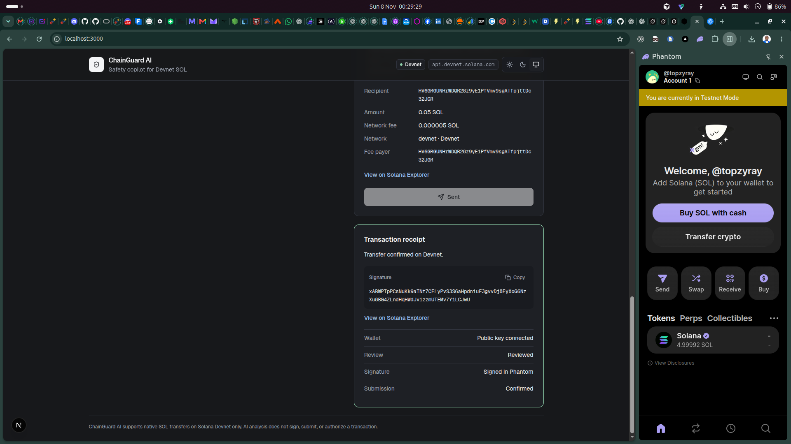
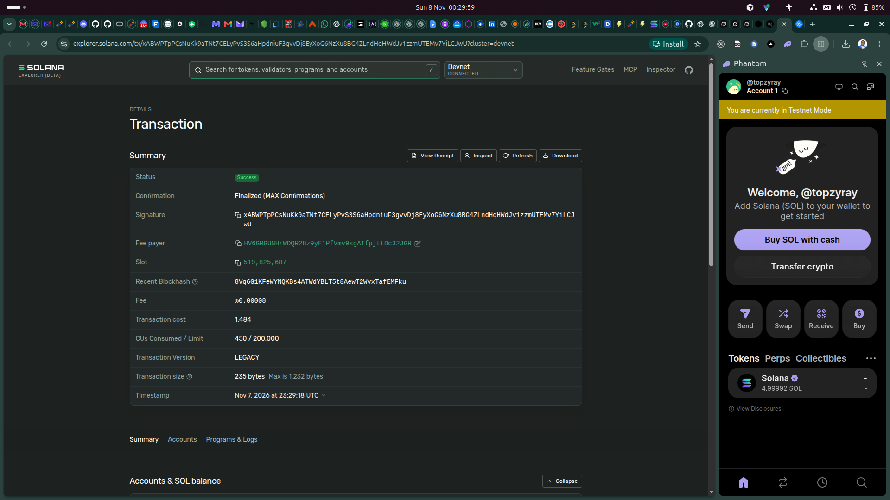
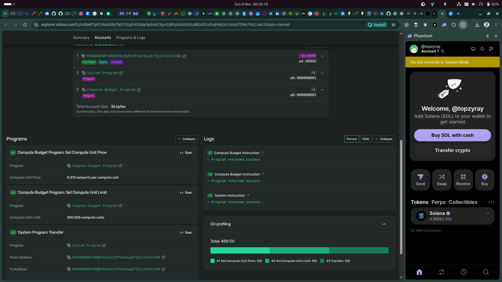

# ChainGuard AI

ChainGuard AI is a safety copilot for native SOL payments on Solana Devnet. You describe a transfer in plain language. The app reads the recipient and the amount, explains the payment, and warns you before anything can be signed. Phantom is the only signer.

The model never signs, submits, or authorizes a transaction. ChainGuard supports native SOL transfers on Devnet only.

## What it does

1. Connect a Phantom wallet and read its public key and Devnet SOL balance. The seed phrase and private key stay in Phantom.
2. Accept one natural-language payment, such as “Send 0.05 SOL to `<address>`”.
3. Send that text to `POST /api/analyze`. OpenAI interprets the instruction. The server then checks the result itself: the recipient must be one canonical Solana address present in the text, and the amount must be one finite positive SOL amount present in the text. Missing or ambiguous fields are not invented.
4. Show the recipient, amount, explanation, and risk warnings. A valid address is not treated as proof of identity. Transfers are described as generally irreversible.
5. Reject requests that are not a native SOL transfer, including swaps, SPL tokens, NFTs, staking, and airdrops.
6. After a clear review, show the exact recipient, the exact SOL amount, the estimated network fee when available, and the Devnet network. Sending requires an explicit **Confirm and Send** click.
7. Build one `SystemProgram.transfer`, ask Phantom to sign and send it, wait for Devnet confirmation, and show a receipt with a copyable signature and a Solana Explorer link (`cluster=devnet`).

## Demo

These screenshots are in [`public/demo`](public/demo). They show one 0.05 SOL Devnet payment from a connected Phantom wallet through confirmation on Solana Explorer.

### 1. Fund a Devnet wallet

The [Solana faucet](https://faucet.solana.com/) sends Devnet SOL to the connected wallet. Phantom must be in testnet mode. This tool does not distribute mainnet SOL.



### 2. Connect Phantom and review the payment

ChainGuard shows the public key and SOL balance. Analyze reads “Send 0.05 SOL to …” as a native SOL transfer and lists the safety warnings. Nothing is signed at this step.



### 3. Transaction preview

The preview repeats the intent, recipient, amount, network, RPC host, and fee payer. The built transaction is still “Not created” until you confirm.



### 4. Explicit confirmation

Confirm and Send is available only after a clear, current review. The panel shows the recipient, 0.05 SOL, the estimated fee, Devnet, and the fee payer.



### 5. Phantom approval

ChainGuard waits. Phantom opens the real transaction for `localhost` and asks you to confirm it. Canceling here rejects the transfer. ChainGuard cannot approve it for you.



### 6. Devnet receipt

After confirmation, the status becomes a receipt: the signature can be copied, and both the confirmation panel and the receipt link to Solana Explorer.



### 7. Explorer confirmation

The same signature is finalized on Devnet. The fee payer matches the connected wallet.



### 8. What landed on-chain

Explorer shows a successful System Program transfer between the fee payer and the recipient, alongside the compute-budget instructions Phantom attached when it submitted the transaction.



## Safety boundaries

- Devnet only. The cluster label in the header is `devnet`.
- Native SOL only. One system transfer. No token approvals, swaps, or arbitrary program calls from this app.
- The connected Phantom account is the only signing authority. There is no server-side signer, and private keys are never requested or stored.
- Analysis output is not trusted on its own. Recipient and amount are taken from the instruction text and checked again before a transaction is built.
- A second click cannot submit a duplicate while a send is in progress, or after a signature already exists.
- Amounts convert to lamports with at most 9 decimal places.

## Requirements

- Node.js 20 or newer
- A Phantom browser wallet, switched to Devnet / testnet mode
- An OpenAI API key and a model name that supports the Responses API with structured output

## Setup

```bash
npm install
```

Create `.env.local` in the project root. This file is gitignored.

```bash
OPENAI_API_KEY=your_key
OPENAI_MODEL=your_model
# Optional. Defaults to the public Solana Devnet RPC.
NEXT_PUBLIC_SOLANA_RPC_URL=https://api.devnet.solana.com
```

`OPENAI_API_KEY` and `OPENAI_MODEL` are read only on the server. Do not prefix them with `NEXT_PUBLIC_`.

Start the app:

```bash
npm run dev
```

Open [http://localhost:3000](http://localhost:3000). Connect Phantom, describe one native SOL transfer, choose Analyze, then Confirm and Send. Approve the transaction in Phantom. Devnet SOL can be requested from [https://faucet.solana.com/](https://faucet.solana.com/).

Other scripts:

```bash
npm run build
npm run start
npm run lint
```

The interface has light mode, dark mode, and a system setting. The choice is stored in the browser.

## How a review is decided

`src/lib/ai.ts` asks the model for a strict object: `intent`, `recipient`, `amountSol`, `explanation`, `warnings`, and `requiresClarification`. `intent` is `transfer`, `unsupported`, or `unclear`.

`reviewAnalysis` does not accept the model’s recipient or amount when they disagree with the text. It keeps a recipient only when the instruction contains exactly one canonical address, and an amount only when it contains exactly one positive SOL amount. Unsupported wording forces `intent` to `unsupported`, clears the recipient, and sets the amount to zero. Two safety warnings are always added: an address is not proof of who controls it, and this analysis does not sign or send.

The client calls `validateSolTransfer` again before building the transaction. Send stays hidden unless the latest review is a clear transfer and the instruction has not been edited since that review.

## Project layout

```text
src/app/page.tsx                 Dashboard page
src/app/api/analyze/route.ts     POST /api/analyze
src/components/                  Wallet, composer, analysis, preview, confirm, receipt
src/lib/ai.ts                    Server-only model call and review rules
src/lib/analysis.ts              Shared response schema
src/lib/transfer.ts              Lamports, the system transfer, Phantom send, confirmation
src/lib/solana.ts                Devnet connection and Phantom provider
public/demo/                     Screenshots used above
```

## Stack

Next.js, React, TypeScript, Tailwind CSS, `@solana/web3.js`, the injected Phantom provider, the OpenAI Responses API, and Zod.
